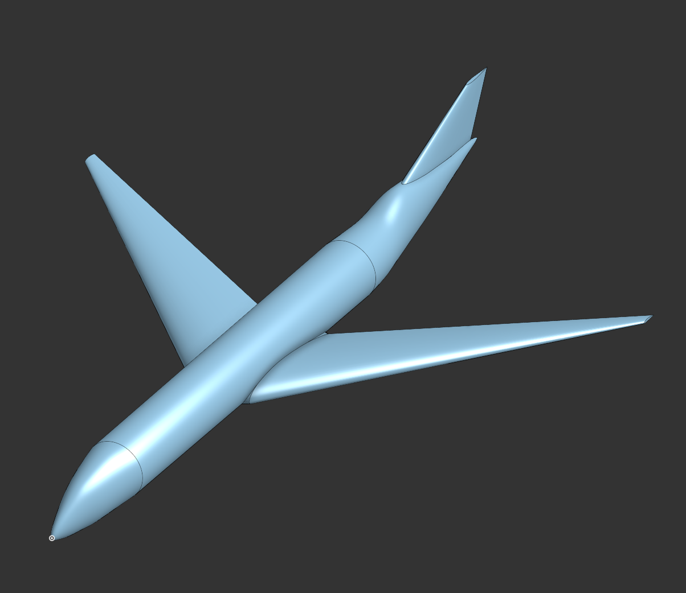
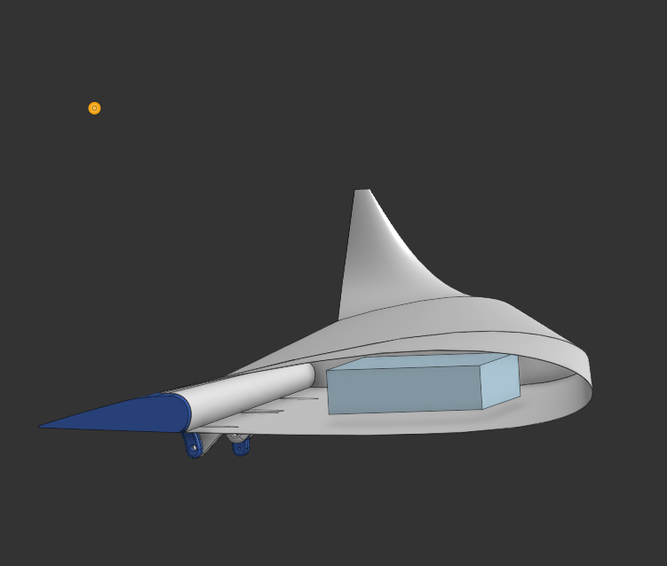
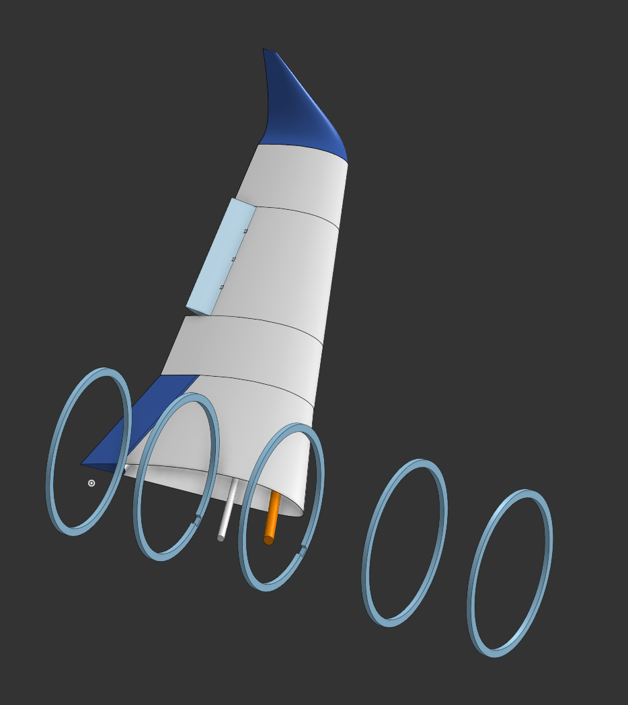
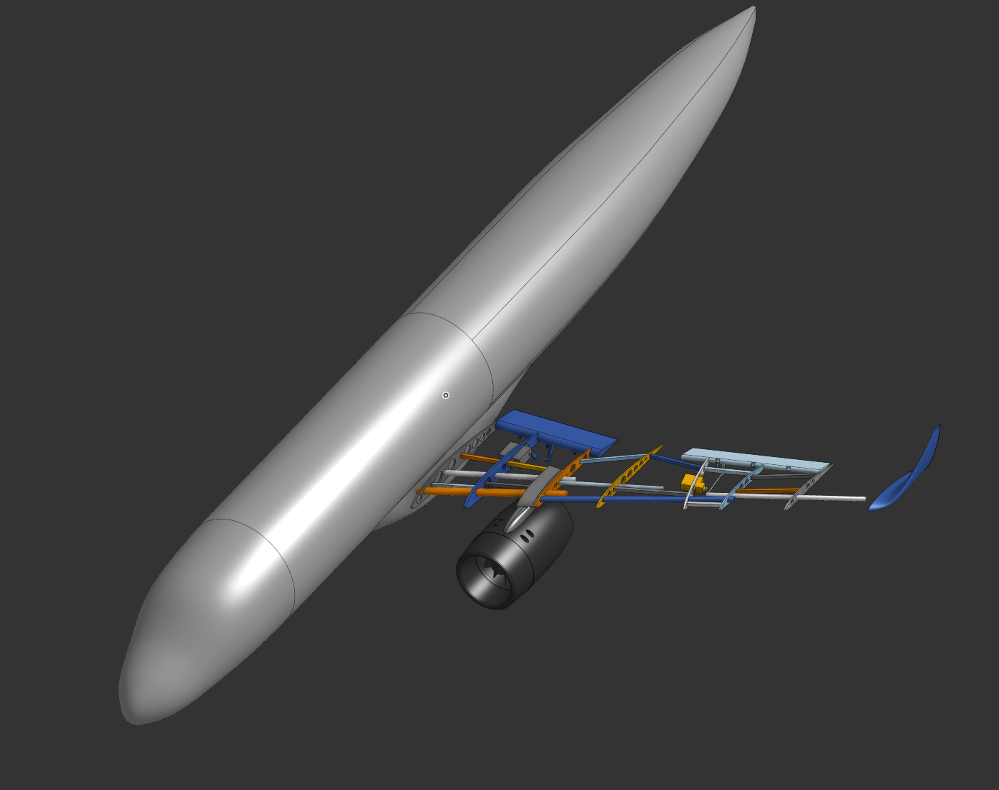
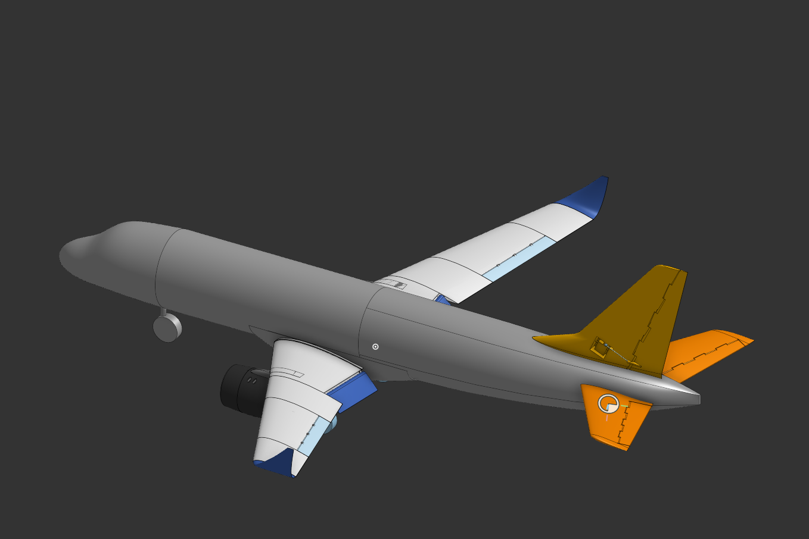
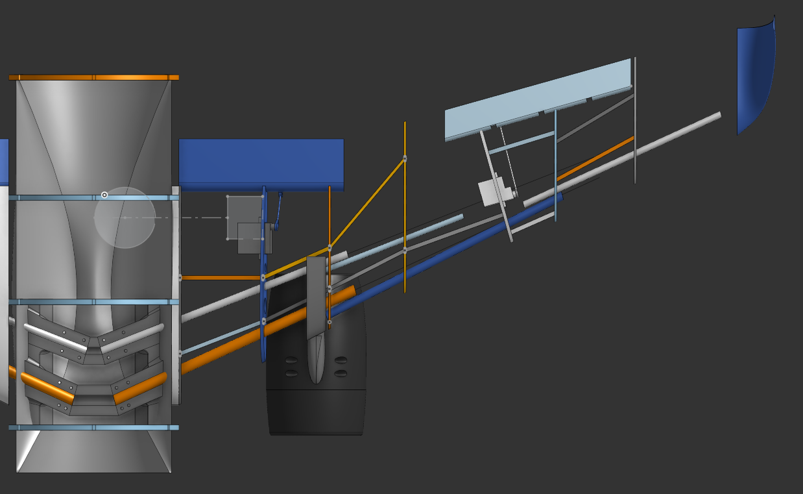
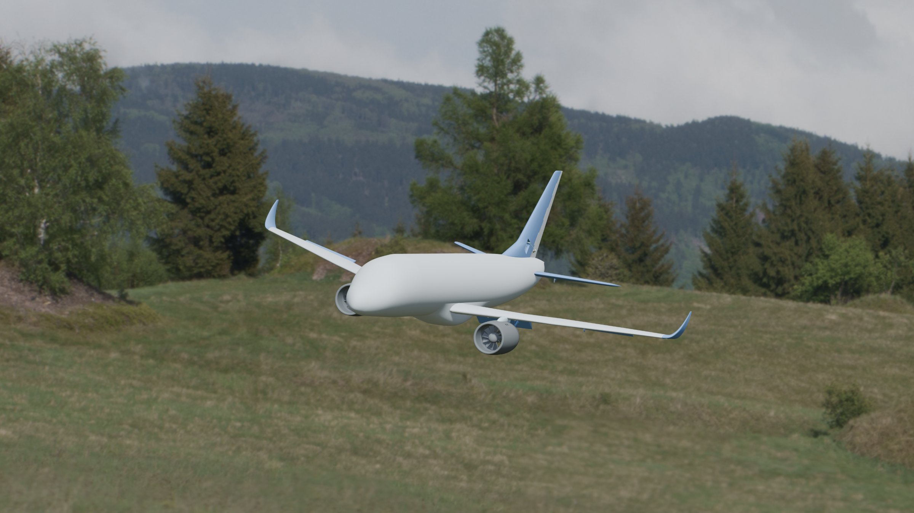
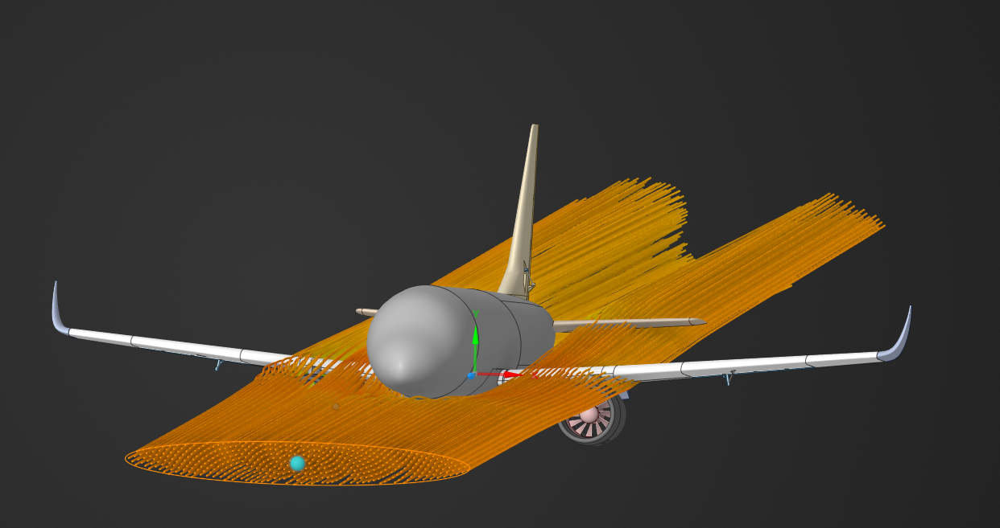

# Journal

## Checkpoint 1 - Basic fuselage CAD
**Date:** 2026-09-13 | **Time tracked:** 33.6h (cumulative)

A very, VERY basic CAD of the plane with only the basic fuselage sketched out.

Next: more CAD + CFD!

## Checkpoint 2 - Restarted CAD, flaps, CFD
**Date:** 2026-09-30 | **Time tracked:** 33.6h (cumulative)

Restarted the CAD! I learned a lot from last time, so now I'm modeling the wing with bulkheads first, then the skin. I added flaps + hinges and the servo + servo arm.

I also ran CFD to find the most optimal landing flap angle (25°) and takeoff flap angle (5°).

## Checkpoint 3 - Ailerons, carbon fiber rods, start of the fuselage
**Date:** 2026-10-14 | **Time tracked:** 33.6h (cumulative)

Added ailerons + carbon fiber wing rods and started work on the ACTUAL fuselage!

The ailerons include the servo + servo arm and can move +/- 25°. It was hard to squeeze the servo in, so I went with a smaller one (DS843MG).

For now I want to 3D print the bulkheads to make life easier, but if they're too big I'll have to find a laser shop for plywood.

## Checkpoint 4 - Fuselage skin, detailed wing, EDFs
**Date:** 2026-10-28 | **Time tracked:** 33.6h (cumulative)

Made the fuselage skin (1/32" balsa sheets) supported by 1/8" balsa stringers.

Made the wing WAYYY more detailed, with WAYYY more carbon fiber rods to help distribute the load.

I FINALLY modeled the EDFs (engines) and chose the Freewing 70mm ones. Each EDF should produce around 2.5 kg of thrust, so the plane should theoretically be able to fly on only ONE EDF. I'll still need to do static thrust testing to verify the real output.

Next: vertical + horizontal stabilizers!

## Checkpoint 5 - Stabilizers and landing gear
**Date:** 2026-11-06 | **Time tracked:** 33.6h (cumulative)

Added the vertical + horizontal stabilizers. I also added the MOTORIZED landing gear! I know they look stupid in my CAD, but I literally cannot find any engineering drawings or CAD for the one I chose.

## Checkpoint 6 - New wing mount and more intricate wing
**Date:** 2026-11-07 | **Time tracked:** 33.6h (cumulative)

A new wing mount + a more intricate wing model!

## Checkpoint 7 - Render
**Date:** 2026-11-09 | **Time tracked:** 43.3h (cumulative)

Made a quick render!

## Checkpoint 8 - CFD validation
**Date:** 2026-11-09 | **Time tracked:** 43.3h (cumulative)

CFD validation! It should work? We're getting ~17 N of thrust at cruise (no flaps).

