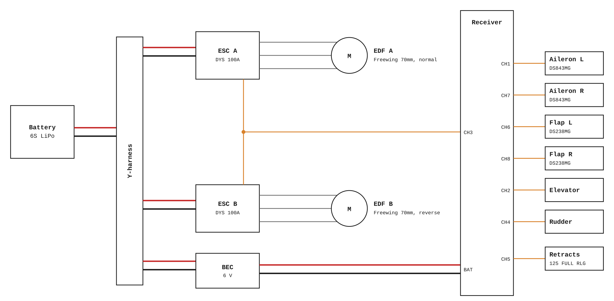

<h1 align="center">Y+ One</h1>

A ~60 inch, custom designed RC airliner with a slotted-flap wing, designed in Onshape and tested in Ansys Discovery.

## Wiring diagram

## Bill of materials

See [BOM.csv](BOM.csv) (about $507 total).

## Files

- `cad/`: Onshape link + STEP/STL exports
- `assets/`: images + wiring diagram
- `BOM.csv`: parts list
- `JOURNAL.md`: build log

## Flight log

| Date | Flight | Notes / issues |
| ---- | ------ | -------------- |

## Status / TODO

- [X] CAD
- [X] CFD
- [ ] Print
- [ ] Maiden flight

## License

This project is licensed under [CC BY-NC 4.0](https://creativecommons.org/licenses/by-nc/4.0/).
You can use, modify, and share it with credit, but not for commercial purposes.
